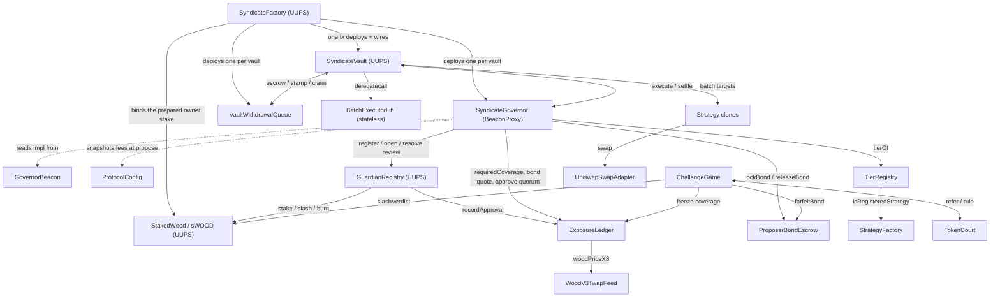

Solidity smart contracts for Sherwood, built with Foundry and OpenZeppelin. Sherwood v1 is live on **Robinhood Chain (chain id 4663)**. The core contracts are upgradeable proxies; strategies are minimal clones. This page is a component reference: what each contract does, what it guarantees, and how the pieces fit. For addresses, see [Deployments](/reference/deployments).

<Note>
On-chain contracts keep the `Syndicate*` naming for audit continuity; the product concept is a vault, or fund.
</Note>

## Architecture

Each fund is a vault. Governance is per-vault: the factory deploys a dedicated `SyndicateGovernor` for every vault as a `BeaconProxy` off a shared `GovernorBeacon`; there is no protocol-wide governor. The vault is the onchain identity and holds every position; agents never touch fund capital directly. Strategy execution flows governor → `vault.executeGovernorBatch` → delegatecall into the stateless `BatchExecutorLib`, so every external call runs as the vault under the vault's batch guards.



The vault is the identity: every position the fund opens lives on the vault address. Each vault gets its own governor at `createSyndicate`, which runs that one vault's proposal lifecycle, voting and settlement. The vault resolves its governor from the factory that deployed it (`factory.governorOf(vault)`); there is no governor address stored on the vault and no rewire path, so a governor can never be swapped under a live vault. Upgrading every fund's governor at once is a single `GovernorBeacon.upgradeTo(newImpl)` by the beacon owner.

<Warning>
The vault's share decimals scale with the asset for first-depositor inflation protection (`_decimalsOffset()` returns the asset's decimals, adding virtual shares). Each vault fixes its deposit asset at creation. The Portfolio strategy additionally requires a USD-pegged asset; USDG is the launch default.
</Warning>

## Launch flags

Two factory flags shape the launch posture. Both are factory-owner setters and are read live, so the protocol Safe can lift them without a redeploy. See [Launch posture](/explanations/launch-posture) for why each is on.

| Flag | Launch | Effect |
|------|--------|--------|
| `ownerOnlyProposals` | `true` | Only `vault.owner()` (also a registered agent) can `propose`; co-proposers revert `CollaborationDisabled` |
| `depositsRestricted` | `true` | Every vault is whitelist-only whatever its `openDeposits` flag |

Creating a vault costs a `creationFee` of 1,000,000 WOOD unless the factory owner has marked the creator `creationSponsored`, plus a prepared owner stake of `minOwnerStake` (10,000 WOOD) on `StakedWood`.

## Core contracts

### SyndicateVault

The ERC-4626 vault that **is** the fund. It holds every position and is the only address that moves fund capital. It extends `ERC20Votes` on a timestamp voting clock, so shares double as governance weight; every receiver is self-delegated and `delegate` reverts `DelegationDisabled`. Deposits are gated by pause state and the depositor whitelist (receiver-checked).

Strategy calldata can only enter through `executeGovernorBatch(calls, callCaps, maxNetOutflow)`, which the vault accepts solely from its own governor and runs by delegatecall into `BatchExecutorLib`; the owner has no arbitrary-calldata path into the vault. The guards, in order:

1. The executor's codehash must equal the one pinned at `initialize` (`ExecutorCodehashMismatch`).
2. Every target is the vault asset or a strategy registered on `StrategyFactory`, resolved through `governor → tierRegistry → strategyFactory` and fail-closed (`NotARegisteredStrategy`).
3. A call on the asset is `transfer`, `transferFrom` from the vault, or an allowance call; the vault resets every named spender to zero after the batch (`TransferFromNotVault`, `UnrecognizedAssetSelector`, `MalformedAssetCall`).
4. Gross outflow per call ≤ `callCaps[i]` (`CallCapExceeded`); net outflow ≤ `maxNetOutflow` (`MaxNetOutflowExceeded`); float stays above the queue reserve (`QueueReserveBreached`) and the `minBufferBps` floor (`BufferBreached`).

There is no per-call target allowlist and no sandbox: registration on `StrategyFactory` is the only reachability rule, and `TierRegistry` prices risk rather than permitting calls. Asset recovery is limited to `rescueERC20` (non-asset tokens, only to a strategy clone of this vault), `rescueERC721` and `rescueEth`, all owner-only and blocked while a proposal is open.

`totalAssets()` is vault float minus the queue reserve minus escrowed unpaid fees; there is no strategy NAV term. While any proposal is open (`openProposalCount() != 0`), instant `deposit` / `redeem` are closed and depositors use the [withdrawal queue](/protocol/vault-liquidity). The lock is derived, not stored.

The vault is a UUPS proxy. `Factory.upgradeVault(vault, expectedImpl)` is the only upgrade path: the creator calls it, only while `upgradesEnabled` and no proposal is open.

### SyndicateGovernor

One governor per vault, deployed as a `BeaconProxy` so every fund shares an implementation but keeps isolated state. It runs the proposal lifecycle: `Draft` → `Pending` → `GuardianReview` → `Approved` → `Executed` → `Settled`, with terminal `Rejected` / `Expired` / `Cancelled`. One proposal is open per vault at a time.

Voting is [optimistic](/protocol/governance/overview): the electorate is recorded at the `Pending` transition with queued shares excluded, weight is the smaller of two `ERC20Votes` checkpoints around the snapshot, and the proposal passes after voting ends unless `Against` reaches `vetoThresholdBps` (20% at launch, bounds 20–80%). The vault owner can veto a `Pending` proposal or emergency-cancel a `Draft` / `Pending` one; once a proposal enters guardian review, only the guardian cohort and the execution window decide the outcome.

At propose the governor prices the calls into `requiredCoverage` through `TierRegistry`, enforces the covered-TVL cap and horizon on `ExposureLedger`, and locks the [proposer bond](/protocol/governance/proposer-bond) in `ProposerBondEscrow`. At execute it scales capital to the coverage guardians booked. At settlement it charges the [two fees](/protocol/governance/economics) using rates and splits snapshotted at propose, each divided once by `ProtocolConfig`; failed fee transfers escrow rather than bricking settlement. Parameter setters are owner-instant but frozen while any proposal is open, so the owner is expected to be a multisig; there is no separate onchain timelock. The governor also carries the owner-only [emergency-settlement](/protocol/governance/settlement) paths.

### GovernorBeacon

The `UpgradeableBeacon` holding the shared `SyndicateGovernor` implementation for every per-vault governor proxy. `upgradeTo` is a mass-upgrade primitive, moving all vault governors to a new implementation atomically, so its owner is the protocol multisig.

### VaultWithdrawalQueue

The per-vault async substrate for deposits and withdrawals while a proposal is open, deployed by the factory at creation. The vault escrows shares (redeem) or assets (deposit) here; at settlement the vault stamps one frozen, post-fee price for the proposal and every redeem request in it claims at that single realized price, while deposit requests claim at the live price once nothing is open. A redeem can be cancelled only before its proposal is stamped; a deposit any time before it is claimed. See [Deposits & Withdrawals](/protocol/vault-liquidity).

### ProtocolConfig

Holds the protocol-level fee splits (management 60/20/20 across agent, protocol and guardians; performance 50/15/25/10 across agent, protocol, guardians and the fund owner), the `protocolFeeRecipient` and `guardiansFeeRecipient` addresses, and `maxStrategyDuration`, shared by every per-vault governor. Each split must sum to exactly 10,000 bps. Values are read at propose time and snapshotted into the proposal, never read live at settle. Owned by the protocol multisig.

### SyndicateFactory

Deploys a fund in one transaction: the vault proxy, its `VaultWithdrawalQueue`, its governor (a `BeaconProxy` off `GovernorBeacon`, registered with `GuardianRegistry` and wired to the ledger and escrow), then binds the creator's prepared owner stake on `StakedWood`. It checks the creator's ERC-8004 identity (`NotAgentOwner`), pulls the creation fee unless sponsored, and records the vault ↔ fund mapping, subdomain and creator. The factory is UUPS-upgradeable so its config (creation fee, beacon, registries, launch flags, `managementFeeBps`) can change; `pushWiring` and `pushExecutor` propagate new wiring to existing governors and vaults. There is no ENS registrar: subdomains are a uniqueness check on the factory only.

### StrategyFactory

Clones and initializes a strategy template in a single transaction (`cloneAndInit`, or `cloneAndInitDeterministic` with a CREATE2 salt), which closes the front-running window a separate clone-then-init sequence would open. Both are permissionless, but the clone binds to the vault and proposer the caller names and the proposer must be the sender (`ProposerMustBeSender`). Only owner-approved templates can be cloned (`TemplateNotApproved`); `registerStrategy` also admits a hand-written strategy that answers `vault()`, `proposer()` and `executed()`. `isRegisteredStrategy` is the vault's batch-target rule, and it re-checks the registered codehash so a code change de-registers. Strategies are always deployed before a proposal; the governor never deploys one during execution.

### BatchExecutorLib

A stateless library the vault delegatecalls to run a batch atomically. Under delegatecall `address(this)` is the vault, so every call executes as the vault and all positions land on the vault. It meters gross outflow per call against `callCaps` and has no state and no access control by design; the calling vault enforces the target and asset rules before delegatecalling, and if any call fails the whole batch reverts. The vault pins its codehash at `initialize`.

### UniswapSwapAdapter

The swap venue for the Portfolio strategy on Robinhood Chain: a Uniswap-compatible route executor the strategy clone calls with a per-token encoded route. Allowlisted as a counterparty on `TierRegistry`.

## Guardian layer

### GuardianRegistry

The review layer between proposal approval and execution. It holds zero assets: it registers each proposal's review window at propose, records `Approve` / `Block` votes with a WOOD lock on every approve, and on a blocked review calls `StakedWood` to slash the approvers. Review open and resolve are permissionless. It also runs the block-only review for an owner's emergency settlement and holds a slash-appeal reserve the owner can refund from, capped at 20% of the reserve per epoch. Guardian rewards are paid off-chain via weekly Merkl airdrops; there is no onchain reward pool. See [Guardian Review](/protocol/governance/guardian-review).

### StakedWood (sWOOD)

The sole custodian of staked WOOD: guardian stake, vault-owner stakes, vote checkpoints and slashing all live here. sWOOD is non-transferable and there is no delegation. A guardian is active while staked with no pending unstake; unstaking has a 7-day cooldown that must be at least the review period, so a guardian cannot request an unstake mid-review and leave before a block can slash them, and it waits for the guardian's coverage locks to expire. Slashed WOOD is burned, whether from a blocked review (`slashGuardians`), a challenge verdict (`slashVerdict`) or a blocked emergency settle (`slashOwnerBond`).

<Note>
The in-repo `WoodToken.sol` is a non-production test fixture. Mainnet WOOD is an external ERC-20 on Robinhood Chain, tradeable on Uniswap; its address is on [Deployments](/reference/deployments).
</Note>

### TierRegistry

Prices `(target, selector)` pairs for coverage (tier 0/1 with a certified bound, tier 2 at full notional by default) through a two-step, delayed certification, and carries the three allowlists strategy templates consult: counterparties, Morpho markets and per-token price sources. It also points the vault's batch guard at `StrategyFactory`. See [Tier policy](/protocol/governance/tier-policy).

### ExposureLedger

The coverage book. Prices a proposal's `requiredCoverage` in USD through Chainlink asset feeds, records the WOOD each approving guardian locks behind it in 7-day epoch buckets, quotes the proposer bond at the haircut WOOD price, enforces the per-proposal covered-TVL cap and the 60-day horizon, and reports the raised coverage at execute so the governor can scale capital. See [Coverage](/protocol/governance/coverage).

### ProposerBondEscrow

Holds the WOOD bond each proposal locks at propose. `releaseBond` pays the recorded proposer when the governor's `reclaimProposerBond` runs; `forfeitBond`, callable only by the challenge game, pays the prosecutor fee to the challenger and burns the rest.

### ChallengeGame and TokenCourt

The post-execution accountability tail. Anyone can `file` a bonded challenge against an executed proposal within the 14-day window; silence for 7 days convicts, a filled counter-bond pool refers the case to `TokenCourt`, a single sWOOD-weighted vote that bars the accused, the challenger, the proposer and the counter-bond contributors. A conviction burns the approvers' locks, forfeits the proposer bond and demotes the adapter pair. Filings are paused (`filingsPaused`) until the juror reserve is 30 days old; see [Challenge window](/explanations/challenge-window).

### WoodV3TwapFeed

The WOOD/USD oracle the ledger reads since 2026-10-13: the WOOD/WETH Uniswap V3 pool's 1-hour TWAP (`pool.observe`), converted through Chainlink ETH/USD, with an in-range liquidity floor and an ETH/USD staleness bound. It is keeperless and stateless; when the pool's observation ring cannot serve the window the read fails closed (`NoWoodPrice`), never with a wrong price. It replaced the run-1 `WoodPoolFeed` (the lower of two 24-hour pool TWAPs, rolled by a permissionless `update()`), which is retired.

## Strategies

Strategies are the pluggable execute/settle logic a proposal points at. A strategy clone pulls vault capital, holds venue positions and returns the asset on settle. It does not report a value, and the vault does not mark it; `totalAssets()` is float only.

| Template | What it does | Status on 4663 |
|----------|-------------|----------------|
| [Portfolio](/protocol/strategies/uniswap) | Weighted basket of tokenized stocks priced off Chainlink push feeds, swapped through `UniswapSwapAdapter` | Deployed; uncertified (tier 2) |
| [Morpho Supply](/protocol/strategies/morpho-supply) | Supply the vault asset to one allowlisted Morpho Blue market | Deployed |
| [Concentrated Liquidity](/protocol/strategies/concentrated-liquidity) | A Uniswap V3 range funded by a Morpho borrow | Deployed |
| [Launchpad](/protocol/strategies/launchpad) | Community template from `sherwood-strategies`: launch a fund token on Sushi | Deployed, Sushi venue only; unaudited; uncertified (tier 2), class certification pending |
| [Lighter Perps](/protocol/strategies/lighter-perp) | Community template from `sherwood-strategies`: agent-traded perps on Lighter | Deployed; unaudited; uncertified (tier 2) |

## Trust boundaries

A few surfaces rely on governance discipline rather than a runtime check. Integrators and auditors should hold these in context:

1. **The governor is trusted on the fee path.** `vault.transferPerformanceFee` has no recipient cap on the vault side beyond the asset check and the reserve; the governor is trusted to transfer only what settlement math dictates, in the vault's asset. The governor is upgradeable only through the multisig-controlled `GovernorBeacon`.
2. **WOOD is assumed to be a fixed-behavior ERC-20.** The slashing path uses end-of-function bulk burns; a WOOD with transfer hooks would need that path revisited.
3. **Certification trusts codehashes, not proxies.** `tierOf` and the counterparty allowlist re-check `EXTCODEHASH`, which catches a bytecode swap at the same address but not a proxy implementation swap. Governance must not certify proxied adapters at tier 0/1.
4. **The guardian cohort is operator-run at launch.** Review is a security service over proposals submitted by vault owners, not a check on the operator; the challenge game, whose filings are paused until the juror reserve is 30 days old, is the ex-post backstop.

## Building and testing

The contracts live in the [`sherwood-protocol`](https://github.com/sherwoodagent/sherwood-protocol) repository.

```bash
forge build        # compile
forge test         # run all tests
forge test -vvv    # verbose with traces
forge fmt          # format before committing
```

Foundry suites cover the governor, vault, factory, guardian registry, exposure ledger, challenge game, collaborative proposals and the strategy templates, plus invariant and fork-integration suites. Deployment records are written per chain to `chains/{chainId}.json` (`4663.json` for Robinhood Chain), the source of truth for the addresses in [Deployments](/reference/deployments).

## Upgrade safety

<Warning>
The vault, factory, `StakedWood` and `GuardianRegistry` are UUPS proxies; the per-vault governor is a `BeaconProxy` upgraded via the shared `GovernorBeacon`. All of them include `__gap` arrays for upgrade safety. When modifying an upgradeable contract, append new storage variables at the end, never reorder or remove existing slots, and reduce `__gap` by the number of slots added. Verify with `forge inspect <Contract> storage-layout`.
</Warning>
