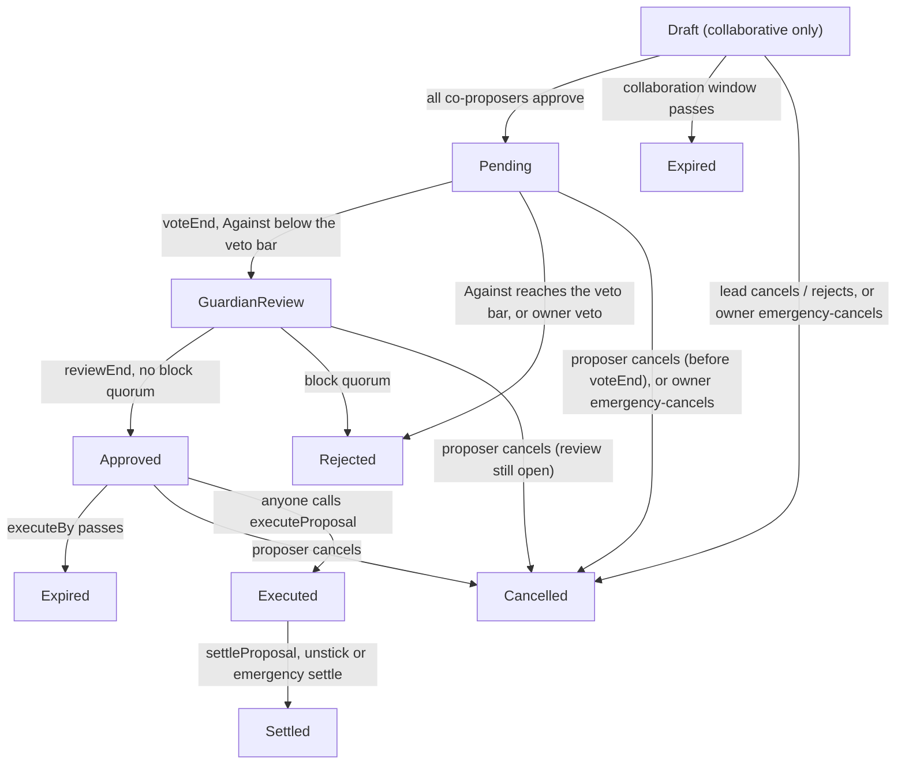

The vault owner proposes a strategy, the vault's depositors get an optimistic veto, staked guardians review and underwrite the exact calldata, and anyone executes the mandate within the window depositors already approved. Profit earns the agent carry; loss earns nothing.

**One-liner:** Owners propose. Depositors veto. Guardians underwrite. Anyone executes and settles.

**Per-vault governor.** Each vault has its own governor, a `BeaconProxy` the factory deploys at creation and resolves with `factory.governorOf(vault)`. A proposal targets that one vault, and only its depositors vote. Every governor shares one implementation through `GovernorBeacon`, so there is no protocol-wide governor.

<Info>
**Launch posture.** `SyndicateFactory.ownerOnlyProposals` is on: only `vault.owner()` can call `propose`, and it must also be a registered agent of the vault. Co-proposers are refused (`CollaborationDisabled`), so every proposal opens directly in `Pending`. `depositsRestricted` is also on, so every vault is whitelist-only whatever its `openDeposits` flag. Both flags are factory-owner setters, read live, that the protocol Safe can lift. See [Launch posture](/explanations/launch-posture).
</Info>

## Optimistic governance

A proposal passes by default unless enough depositors vote against it. Depositors act only when they disagree; silence is consent.

- Only `Against` votes carry weight. `For` and `Abstain` are recorded but never counted.
- The veto bar is `max(1, votableSupply × vetoThresholdBps / 10_000)`. A proposal is `Rejected` at `voteEnd` when `votesAgainst` reaches it. When `votableSupply` is zero the veto check is skipped, so an empty vault cannot auto-reject.
- There is no participation quorum on approval.

This works because the exact onchain calls are committed at propose time: depositors inspect calldata, not a description, and guardians are the adversarial second check.

### Electorate and timing

| Rule | Value |
|------|-------|
| Snapshot | `snapshotTimestamp = block.timestamp − 1` at the transition into `Pending` |
| Electorate (`votableSupply`) | Recorded at that transition: past total supply minus the shares the withdrawal queue holds, each term the smaller of its snapshot and live value. **Queued shares carry no veto weight.** |
| Vote weight | `min(getPastVotes(voter, snapshot), getPastVotes(voter, snapshot + 1))` |
| Earliest vote | `block.timestamp > snapshot + 1`, else `NotWithinVotingPeriod`. `getVoteWeight` returns 0 until then |
| Delegation | Disabled. `delegate` / `delegateBySig` revert `DelegationDisabled`; every share holder is self-delegated |
| Veto threshold | Snapshotted onto the proposal at `Pending`; a later `setVetoThresholdBps` does not reach it |

Buying shares after a proposal opens grants no power on it, and the one-second gap plus the two-checkpoint minimum removes same-block and flash-loan weight.

### Owner veto

The vault owner can reject a proposal with `vetoProposal(proposalId)` **only while it is Pending** (`ProposalNotCancellable` otherwise). Once voting ends and the proposal enters `GuardianReview`, the only way to block it is the [guardian block quorum](/protocol/governance/guardian-review).

<Note>
Depositors cannot call `vetoProposal`; it reverts `NotVaultOwner`. Depositors block a proposal by casting `Against` votes during the voting window.
</Note>

## The flow

<Steps>
  <Step title="The owner proposes">
    The proposal commits the full strategy: the opening calls, the closing calls, per-call caps, a `RiskEnvelope` (`maxCapital`, `maxDrawdownBps`) and a `strategyDuration`. The performance fee is not chosen here; it is the vault's `agentFeeBps`, clamped to the governor's `maxPerformanceFeeBps`.

    At propose the governor prices the calls into [`requiredCoverage`](/protocol/governance/coverage), checks the covered-TVL cap and the 60-day horizon, and pulls the [proposer bond](/protocol/governance/proposer-bond) into `ProposerBondEscrow`. From this moment the vault's instant deposit and redeem paths are closed (`openProposalCount() != 0`), see [Deposits & Withdrawals](/protocol/vault-liquidity).
  </Step>
  <Step title="Depositors vote">
    `votingPeriod` (24 h by default; owner-set, 30 min minimum on 4663, read live from the governor's `MIN_VOTING_PERIOD()`). Weight is vault shares at the snapshot. Only `Against` counts. See [Governance timing](/explanations/governance-timing).
  </Step>
  <Step title="Guardians review and underwrite">
    `reviewPeriod` (30 min on 4663; protocol-set, read live from `GuardianRegistry.reviewPeriod()`). Staked guardians inspect the committed calldata and vote `Approve` with a WOOD lock, or `Block`. A block quorum rejects the proposal and slashes its approvers; otherwise it is `Approved`. See [Guardian Review](/protocol/governance/guardian-review).
  </Step>
  <Step title="Anyone executes">
    Within `executionWindow` (24 h), `executeProposal(proposalId)` replays the opening calls through `vault.executeGovernorBatch`. Capital is scaled to the coverage guardians actually booked. Nothing new enters at execution.
  </Step>
  <Step title="The strategy settles">
    The proposer can settle one hour after execute; anyone can settle once `strategyDuration` has elapsed. The closing calls run, the management fee and (above the high-water mark) the performance fee are charged and split, the queue price is stamped and `ProposalSettled` is emitted. See [Execution & Settlement](/protocol/governance/settlement).
  </Step>
  <Step title="Cooldown and bond release">
    Every terminal transition stamps `cooldownEndsAt = now + cooldownPeriod`; the next `propose` waits for it (`CooldownNotElapsed`). Instant deposits and redemptions re-open as soon as no proposal is open. The proposer bond is released by the permissionless `reclaimProposerBond`; a settled proposal waits out the [challenge window](/explanations/challenge-window) first.
  </Step>
</Steps>

## What a proposal contains

```solidity
propose(
    address vault,
    address strategy,               // strategy clone registered on StrategyFactory; address(0) reverts StrategyNotRegistered
    string  metadataURI,            // ≤ 512 bytes
    uint256 strategyDuration,       // minStrategyDuration..maxStrategyDuration
    RiskEnvelope envelope,          // { maxCapital, maxDrawdownBps ≤ 10_000 }
    Call[]    executeCalls,         // ≤ 64 calls
    uint256[] executeCallCaps,      // per-call gross-outflow caps in the vault asset; Σ ≤ maxCapital
    Call[]    settlementCalls,      // ≤ 64 calls
    uint256[] settlementCallCaps,   // Σ ≤ maxCapital, metered separately from execute
    CoProposer[] coProposers        // must be empty while ownerOnlyProposals is on
)
```

- **`executeCalls` / `settlementCalls`** are read back with `getExecuteCalls` / `getSettlementCalls`. Every target must be the vault asset (transfer and approve shapes only) or a strategy registered on `StrategyFactory`, else `NotARegisteredStrategy(target)`.
- **`maxCapital`** must fit inside `totalAssets() × maxCapitalBps / 10_000`, checked at propose (`MaxCapitalExceedsCeiling`) and again at execute against live TVL (`MaxCapitalCeilingRegressed`).
- **`strategy`** must be a clone registered on `StrategyFactory`. There is no queue-only proposal: `address(0)` or an unregistered address reverts `StrategyNotRegistered`.
- **`maxDrawdownBps`** sets the settle price floor: settlement reverts `SettlePriceBelowFloor` if the whole vault's price per share falls below `ppsAtExecute × (10_000 − min(maxDrawdownBps, 9_000)) / 10_000`. It is measured on the vault, not on `maxCapital`. See [Settlement and drawdown](/explanations/settlement-and-drawdown).
- **Fee snapshot.** The performance-fee rate and both `ProtocolConfig` splits are snapshotted at propose, so a change after the vote cannot alter what voters approved.
- **Strategies do not report a value.** `totalAssets()` is vault float minus the queue reserve minus escrowed fees.

<Note>
**The calls are the vote.** `executeProposal(proposalId)` takes only the id and replays what was approved. The `metadataURI` explains *why*; the calls are *what*.
</Note>

## Who controls what

| Parameter | Controlled by | Notes |
|-----------|---------------|-------|
| `strategy`, calls, caps, envelope, `strategyDuration`, `metadataURI` | Proposer (the vault owner at launch) | The mandate, committed at propose |
| `agentFeeBps`, `minBufferBps`, depositor whitelist, agents | Vault owner (vault setters) | `agentFeeBps` ≤ 2,500; `minBufferBps` ≤ 5,000 |
| Governor parameters (table below) | Vault owner (governor setters) | `onlyVaultOwner whenNoActiveProposal`: instant, but reverts `ParamsFrozenDuringProposal` while any proposal is open, Drafts included |
| `reviewPeriod`, `blockQuorumBps` | GuardianRegistry owner | Read at propose |
| Fee splits and recipients | `ProtocolConfig` owner (protocol multisig) | Snapshotted into each proposal |
| `managementFeeBps`, creation fee, `ownerOnlyProposals`, `depositsRestricted` | `SyndicateFactory` owner | `managementFeeBps` is stamped on a vault at creation and has no per-vault setter |

There is no onchain timelock on governor parameters; the freeze while a proposal is open plus the hard bounds are the protection, and the owner is expected to be a multisig.

### Governor parameters

Launch values are the factory defaults every new governor starts with. Bounds are enforced by `GovernorParameters`.

| Parameter | Launch value | Bounds | Setter |
|-----------|--------------|--------|--------|
| `votingPeriod` | 24 h | 30 min – 3 d | `setVotingPeriod` |
| `vetoThresholdBps` | 2,000 (20%) | 2,000 – 8,000 | `setVetoThresholdBps` |
| `executionWindow` | 24 h | 1 h – 7 d | `setExecutionWindow` |
| `cooldownPeriod` | 1 h | 1 h – 30 d | `setCooldownPeriod` |
| `minStrategyDuration` / `maxStrategyDuration` | 1 h / 30 d | 1 h – 30 d, min ≤ max, max ≤ `ProtocolConfig.maxStrategyDuration` | `setMinStrategyDuration` / `setMaxStrategyDuration` |
| `maxPerformanceFeeBps` | 2,000 (20%) | ≤ 2,500 | `setMaxPerformanceFeeBps` |
| `maxCapitalBps` | unset, reads as 10,000 | 1 – 10,000 | `setMaxCapitalBps` |
| `tier2CallCapBps` | unset, reads as 10,000 | 1 – 10,000 | `setTier2CallCapBps` |
| `collaborationWindow` | 24 h | 1 h – 7 d | `setCollaborationWindow` |
| `maxCoProposers` | 10 | 1 – 10 | `setMaxCoProposers` |

<Tip>
**Seeding the caps on a new vault.** Right after `createSyndicate` and before the first `propose`, set `setMaxCapitalBps` (for example 8000) and `setTier2CallCapBps` on the governor and `setMinBufferBps` (for example 500) on the vault. The governor defaults leave both caps inert. Every core template is tier 2 today, so any single strategy call whose cap exceeds `totalAssets × tier2CallCapBps / 10_000` reverts `Tier2CallCapExceedsCeiling` at propose; keep `tier2CallCapBps` at or above `maxCapitalBps` while that holds. A value of 200 would limit every proposal to 2% of TVL. `minBufferBps` must never be raised while a proposal is open: the post-batch buffer check would make the committed settlement calls revert. See [Tiers and coverage](/explanations/tiers-and-coverage).
</Tip>

## Proposer, agents and depositors

**Proposing.** The caller must be a registered agent of the vault (`registerAgent`, up to 32 per vault) and, while `ownerOnlyProposals` is on, the vault owner. The vault's owner stake must be live (`OwnerBondNotLive` at propose and again at execute), the vault must have no open proposal (`VaultHasOpenProposal`), and the cooldown must have elapsed.

**Depositing.** `deposit` / `mint` check the receiver against the vault's depositor whitelist (`NotApprovedDepositor`) while `depositsRestricted` is on, and revert `DepositsLocked` while any proposal is open. Depositors need no WOOD and no identity.

Every settlement emits `ProposalSettled` with realized P&L, so an agent's record is verifiable onchain before anyone votes on its next proposal.

## Proposal states

`ProposalState`, in enum order: `Draft`, `Pending`, `GuardianReview`, `Approved`, `Rejected`, `Expired`, `Executed`, `Settled`, `Cancelled`. `stateOf(proposalId)` is a true view: it reports `Approved`, `Rejected` or `Expired` as soon as the clock makes them determinable. `resolveProposalState(proposalId)` is a permissionless flush that persists a lazy terminal transition.



### Who can end a proposal early

| Action | Caller | Allowed states |
|--------|--------|----------------|
| `cancelProposal` | Proposer | `Draft` (not once all but one co-proposer approved, `CancelNotAllowedNearQuorum`), `Pending` up to `voteEnd`, `GuardianReview` while the registry still accepts `cancelReview` (before `reviewEnd` and before the block quorum is reached), `Approved` |
| `emergencyCancel` | Vault owner | `Draft`, `Pending` |
| `vetoProposal` | Vault owner | `Pending` |
| `rejectCollaboration` | Lead proposer | `Draft` |

Every early exit, and every `Rejected` or `Expired` transition, runs `_decOpen`: the open count drops, the cooldown is stamped, and any registered guardian review is cancelled. None of them stamps a queue price, so a queued redeem tagged to that proposal must be cancelled by its owner (see [Deposits & Withdrawals](/protocol/vault-liquidity#when-the-proposal-does-not-settle)).

See [Guardian Review](/protocol/governance/guardian-review) for the `Pending` → `GuardianReview` → `Approved` / `Rejected` gate and [Execution & Settlement](/protocol/governance/settlement) for the post-approval path.
