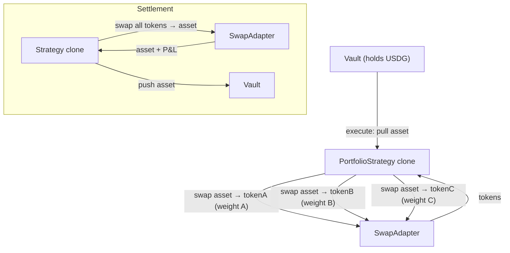

The `PortfolioStrategy` manages a weighted basket of up to 20 tokens. On execute it swaps the vault's asset into each token at its target weight; on settle it sells everything back to the asset. While the proposal is `Executed`, the proposer can call `rebalanceDelta()` to swap the drift back toward the weights the proposal committed to, priced off each token's Chainlink push feed.

The basket is **frozen at init**: weights and swap routes cannot be changed for the life of the proposal, and the slippage tolerance can only be tightened. Depositors approve a basket, not a mandate. See [Oracle staleness](/explanations/oracle-staleness) for the frozen-weights and feed-age rules together.

**The vault asset must be USD-pegged.** `_requireUsdPegged` runs at init and at execute: the exposure ledger's `coverageUsd` for one unit of the asset must be within ±1% of $1 (`PEG_TOLERANCE_BPS` 100), else `AssetNotUsdPegged`. On Robinhood Chain (4663) that means a **USDG** vault. The basket is drawn from the tokenized stocks with a Chainlink push feed in the address book (see [Deployments](/reference/deployments)).

<Note>
The Portfolio class is uncertified (tier 2), so its calls price at full notional. The CLI gives the settle call a cap of 0, so `requiredCoverage` ≈ the deployed amount (1×), and the [proposer bond](/protocol/governance/proposer-bond) ≈ 2% of it in WOOD at market price (1% of coverage at a 50% WOOD haircut). See [Tiers and coverage](/explanations/tiers-and-coverage).
</Note>

## Swaps and the swap adapter

The strategy is DEX-agnostic: it never hardcodes a venue, it calls a pluggable **swap adapter**. On Robinhood Chain the deployed adapter is the `UniswapSwapAdapter`, pointed at the chain's official Uniswap deployment. The adapter must be an allowed counterparty on `TierRegistry` (`AdapterNotAllowed` otherwise), checked at init and at execute.

Route selection is done **CLI-side**: by default the CLI quotes each leg at its real allocation across the V3 fee tiers and picks the best direct asset→token pool. `--swap-routes` overrides a slot with a V3 single-hop, a V4 single-hop or a V4 multi-hop path. The CLI encodes the chosen route into each token's `swapExtraData`. The on-chain adapter does not auto-detect: it reads a leading mode byte from the route data and executes exactly that route, which is how the basket can hold tokens without a liquid direct pair.

<Note>
  `swapExtraData` is a per-token route encoding: a 1-byte mode prefix followed by the ABI-encoded route.

  | Mode | Route | Encoded data |
  |------|-------|--------------|
  | `0` | Uniswap V3 single-hop | `uint24 fee` |
  | `2` | Uniswap V4 single-hop, hookless pool | `(uint24 fee, int24 tickSpacing)` |
  | `3` | Uniswap V4 multi-hop, hookless pools | `PathHop[] hops`, each `(address currency, uint24 fee, int24 tickSpacing)` |

  Any other mode reverts `UnsupportedMode`, including the retired V3 multi-hop mode `1`. Mode 3 accepts native ETH as an intermediate hop only; both endpoints must be ERC-20s. The CLI fills this in for you.
</Note>

## Architecture



## Lifecycle

```
Pending → execute() → Executed → (rebalance?) → settle() → Settled
```

| Phase | What happens | Who calls |
|-------|-------------|-----------|
| **Execute** | Pull asset → swap to each basket token at target weight (via the swap adapter) | Governor (proposal execution) |
| **Executed** | Proposer can `rebalanceDelta()`, or tighten `maxSlippageBps` | Proposer |
| **Settle** | Swap all tokens back to asset → push to vault | Governor (proposal settlement) |

### Batch calls

```
Execute: [asset.approve(strategy, totalAmount), strategy.execute()]
Settle:  [strategy.settle()]
```

## Init parameters

Init data is an **ABI-encoded positional tuple** (not a named struct). Tokens, weights, routes, feed decimals, and feeds are passed as **parallel arrays** — same length, same order:

```solidity
(
    address   asset,             // Vault asset
    address   swapAdapter,       // Deployed swap adapter (UniswapSwapAdapter)
    address[] tokens,            // Basket tokens
    uint256[] weightsBps,        // Target weight per token in bps (sum = 10000)
    uint256   totalAmount,       // Total asset to deploy
    uint256   maxSlippageBps,    // Per-swap slippage cap — REQUIRED, 50–1000 bps
    bytes[]   swapExtraData,     // Per-token adapter route data (mode byte + encoded path)
    uint8[]   priceDecimals,     // Per-token feed scale (8 for stocks, 18 for crypto)
    address[] feeds              // Per-token Chainlink AggregatorV3 push-feed address
)
```

- `asset` must be the vault asset (`AssetNotVaultAsset`) and USD-pegged (`AssetNotUsdPegged`; `ExposureLedgerUnresolved` if the vault's governor has no ledger wired yet).
- Max basket size: **20 tokens** (`MAX_BASKET_SIZE`, `TooManyTokens`); duplicate token addresses are rejected (`DuplicateToken`).
- Weights are in basis points and **must sum to 10000** (`InvalidWeights`).
- `maxSlippageBps` applies to every swap (entry, settle, and rebalance). It is **required** and bounded `MIN_SLIPPAGE_BPS` (50) to `MAX_SLIPPAGE_CEILING_BPS` (1000), else `InvalidSlippage`.
- Each `feeds[i]` must be non-zero and is bound **per slot**, so a price for one token cannot be used for another's. Three checks run at init: the feed must be allowed on `TierRegistry.isCounterpartyAllowed` (`PriceSourceNotAllowed`), it must be the feed paired to that token (`isPriceSourceForToken`, else `PriceSourceNotPairedWithToken`), and its live `decimals()` must equal `priceDecimals[i]` (`InvalidPriceDecimals`).

<Note>
v1 prices every slot from a **Chainlink push feed** (`AggregatorV3Interface.latestRoundData`), with a flat `MAX_PUSH_PRICE_AGE` of 26 hours (24h heartbeat + 2h grace) on every read: at execute (buy floors), at settle (sell floors) and at rebalance. There is no Data Streams path and no per-slot max age.
</Note>

<Warning>
**Weekend gap.** Chainlink stock feeds on Robinhood Chain stop updating when US markets close for the weekend and the gap runs well past the 26-hour bound, so from about Saturday evening until Monday 00:00 UTC every feed read on a stock basket reverts `StalePrice`: the proposal cannot execute, settle or rebalance in that window. Time the 24-hour execution window and the end of `strategyDuration` to fall on weekdays, and do not hold a stock across an announced split (the feed and the token re-base at different moments). This is operational guidance; the contract rule is only the 26-hour bound.
</Warning>

## Rebalancing

While the proposal is `Executed`, the proposer can call **`rebalanceDelta()`** — no arguments, proposer-only. It prices every slot off that slot's bound push feed, then swaps only the drift away from the **init** weights: sell the overweight legs, buy the underweight ones. A reading older than `MAX_PUSH_PRICE_AGE` reverts `StalePrice`.

These prices size the delta swaps and nothing else. They are **not** a vault NAV source, so a stale or missing feed can block a rebalance but can never move deposit/redeem pricing.

There is no full `rebalance()` (sell-all, re-buy) and no way to re-weight mid-proposal: the weights voters approved are the weights the rebalance targets.

## Vault liquidity during a proposal

While a proposal on this strategy is executing, instant vault deposits and redeems are closed. Exits and entries go through the [async queue](/protocol/vault-liquidity): `requestDeposit` / `requestRedeem` escrow in the withdrawal queue and settle at the single frozen, realized per-proposal price. The vault does not mark the basket — `totalAssets()` is float minus queue reserve minus escrowed fees.

The `rebalanceDelta` push-feed path above is independent of this — it prices delta swaps during a rebalance, never vault NAV. See [Deposits & Withdrawals](/protocol/vault-liquidity) for the queue model.

## Tunable parameters (Executed state)

Only one, and only downward: the proposer may **tighten** `maxSlippageBps` (never loosen it, and never below 50 bps). Target weights and per-token `swapExtraData` routes are frozen at init — attempting to change either reverts `WeightsFrozen` / `RoutesFrozen`.

## Risk notes

- **Swap impact:** large allocations in thin pools can eat into P&L — set `maxSlippageBps` conservatively.
- **Oracle staleness:** every feed read rejects a reading older than 26 hours (`StalePrice`), and execute and settle read the feeds for their swap floors, not only `rebalanceDelta`. A stale feed delays the strategy until the feed recovers (see the weekend gap above). These readings size swap floors, so staleness never affects deposit/redeem pricing.
- **Settle path:** `settle()` sells every token back to the asset in one transaction, along the routes committed at init. A single illiquid token can revert the whole settlement, and routes cannot be changed after the fact; pick them carefully at propose time. If settlement cannot clear, the owner's `unstick` or emergency path is the exit.
- **Coverage:** uncertified (tier 2), so each proposal books about its deployed capital against the guardian cohort's coverage, and the guardians' free budget caps how much the basket can deploy. Each strategy call must also fit `totalAssets × tier2CallCapBps / 10,000` ([Tiers and coverage](/explanations/tiers-and-coverage)).

## CLI usage

```bash
sherwood strategy propose portfolio \
  --vault 0x... \
  --amount 1000 \
  --tokens TSLA,AMZN,PLTR,NVDA,AAPL \
  --weights 2500,2500,2000,1500,1500 \
  --max-slippage 500 \
  --name "Stock Basket" \
  --duration 7d
```

| Flag | Description | Default |
|------|------------|---------|
| `--amount <n>` | Total asset to allocate | required |
| `--tokens <list>` | Comma-separated token addresses or symbols | required |
| `--weights <list>` | Comma-separated weights in bps (sum = 10000) | required |
| `--max-slippage <bps>` | Per-swap slippage cap (50–1000) | 500 |
| `--max-slippage-per-leg <list>` | Per-leg slippage bps aligned to `--tokens`. The strategy holds one `maxSlippageBps`, so the largest leg is used. Mutually exclusive with `--max-slippage` | none |
| `--feeds <list>` | Chainlink AggregatorV3 push-feed address per token, **slot-aligned to `--tokens`**. Leave a slot empty (`0xA,,0xC`) to auto-resolve it from the registry | auto-resolved |
| `--price-decimals <list>` | Raw feed decimals per token; must equal the feed's live `decimals()` | 8 |
| `--fee-tier <n>` | Pool fee tier for route probing | 3000 |
| `--swap-routes <list>` | Per-token route spec: `v3:<fee>` (mode 0), `v4:<fee>:<tickSpacing>` (mode 2) or `v4path:<hop>+<hop>...` (mode 3), where a hop is `<currency>@<fee>:<tickSpacing>` and the currency is `eth`/`native`, `self` or an address. An empty entry auto-detects | auto-detected |
| `--swap-adapter <address>` | Override swap adapter address | auto-detected |
| `--max-drawdown-bps <bps>` | Largest fall in the whole vault's price per share between execute and settle that settle accepts (capped at 9,000 on chain). See [Settlement and drawdown](/explanations/settlement-and-drawdown) | 2000 |

`sherwood strategy rebalance` takes only a **lower** `--max-slippage`; weights and routes are frozen at init.

## Addresses

The `PortfolioStrategy` template (`PORTFOLIO_TEMPLATE`), the `UniswapSwapAdapter` and the per-token Chainlink push feeds (`CHAINLINK_<SYM>_USD_FEED`) for Robinhood Chain are listed on [Deployments](/reference/deployments), sourced from `chains/4663.json`.
