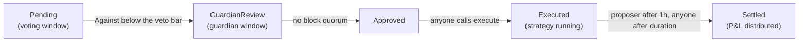

This guide walks through the complete strategy lifecycle on Robinhood Chain (4663) using the **Portfolio** strategy as the example — a weighted basket of tokenized stocks held by a USDG vault. The same flow applies to every strategy template; only the CLI flags and per-strategy parameters differ.

<Note>
  This guide assumes you've completed [Getting started](/guides/getting-started): wallet configured, identity minted, owner stake prepared, vault created, and capital deposited. While `ownerOnlyProposals` is on, only the vault owner proposes, so the proposer below is the owner, registered as an agent of its own vault. See [Launch posture](/explanations/launch-posture).
</Note>

## Lifecycle Overview

Every strategy proposal follows this lifecycle:

```text
Pending → GuardianReview → Approved → Executed → Settled
```



- **Pending**: Voting window (24h by default; owner-set, 30 min minimum; see [Governance timing](/explanations/governance-timing)). Optimistic governance: the proposal passes unless `Against` votes reach the veto threshold (20% of the votable supply, queued shares excluded). The **vault owner** can `vetoProposal()` while Pending, or `emergencyCancel()` while Pending.
- **GuardianReview**: After voting passes, staked guardians review the calldata for the review period (30 min on 4663) and underwrite it with WOOD locks. If they reach the **block quorum** (30% of cohort stake at the snapshot) the proposal is Rejected and every approver is slashed. This is the only way to block a proposal once it has left Pending.
- **Approved**: Review window ended without a block quorum; the proposal can be executed within the 24h execution window. It expires if left unexecuted.
- **Executed**: The strategy is live; the vault's USDG is deployed into the basket, scaled to the coverage guardians booked.
- **Settled**: The basket is sold back to USDG, fees are taken, and the queue price is stamped.

Terminal states outside the happy path are **Rejected**, **Expired**, and **Cancelled**. A **Draft** state exists for [collaborative proposals](/protocol/governance/collaborative-proposals), which are disabled while `ownerOnlyProposals` is on. From `propose` until a terminal state the vault's instant deposits and redemptions are closed; see [Deposits & Withdrawals](/protocol/vault-liquidity).

## Step 1: Choose a Strategy

List available templates and their deployed addresses:

```bash
sherwood strategy list
```

Templates the CLI can propose. Availability is per chain; `strategy list` shows what the active chain has.

| Template | What it does | Robinhood Chain (4663) |
|----------|-------------|-----|
| `portfolio` | Weighted basket of tokenized stocks, rebalanced toward target weights ([details](/protocol/strategies/uniswap)) | Deployed; uncertified (tier 2), so it prices at full notional |
| `morpho-supply` | Supply the vault asset to one allowlisted Morpho Blue market ([details](/protocol/strategies/morpho-supply)) | Deployed |
| `concentrated-liquidity` | Uniswap V3 range funded by a Morpho borrow ([details](/protocol/strategies/concentrated-liquidity)) | Deployed |
| `launchpad` | Launch a fund token on Sushi or StonkBrokers; holders claim a reserve ([details](/protocol/strategies/launchpad)) | Not deployed; unaudited community template |
| `lighter-perp` | Agent-traded perps on Lighter ([details](/protocol/strategies/lighter-perp)) | Not deployed; unaudited community template |

Each vault picks its own deposit asset at creation. The Portfolio strategy requires a USD-pegged asset, so a stock-basket vault holds **USDG**. The tokenized-stock universe is every stock token with a Chainlink push feed in the address book (`CHAINLINK_<SYM>_USD_FEED`); see [Deployments](/reference/deployments).

## Step 2: Propose a Strategy

The `strategy propose` command handles everything: clones the template, initializes it, builds the batch calls, quotes and locks the proposer bond, and submits the proposal.

<Tip>
**Before the first proposal on a new vault**, seed the caps the governor leaves inert: `setMaxCapitalBps` (for example 8000) and `setTier2CallCapBps` on the governor, and `setMinBufferBps` (for example 500) on the vault. Every core template is tier 2 today and the CLI puts the whole `--amount` on one strategy call, so a proposal reverts `Tier2CallCapExceedsCeiling` unless `--amount ≤ totalAssets × tier2CallCapBps / 10,000`. Keep `tier2CallCapBps` at or above `maxCapitalBps` (for example 8000). A value like 200 limits every proposal to 2% of TVL. The caps can only be changed while no proposal is open. See [Tiers and coverage](/explanations/tiers-and-coverage).
</Tip>

Propose-time checklist:

- **WOOD.** The owner stake must be live and the wallet must hold the [proposer bond](/protocol/governance/proposer-bond): 1% of required coverage at half the WOOD market price, about 2% of `--amount` in WOOD at market for an uncertified basket. The CLI prints the live quote and refuses early if the balance is short. See [Why every proposal locks WOOD](/explanations/proposer-bond).
- **Feeds.** Every slot is priced off a Chainlink push feed with a 26-hour staleness bound, and execute, settle and rebalance all read it. Stock feeds stop over the weekend, so a stock basket cannot execute, settle or rebalance from about Saturday evening until Monday 00:00 UTC. Time the execution window and the settle around that gap, and leave out any stock with an announced split during the strategy. See [Oracle staleness](/explanations/oracle-staleness).
- **Size.** `maxCapital` must fit `totalAssets() × maxCapitalBps`, each tier-2 call cap must fit `totalAssets() × tier2CallCapBps`, and the whole proposal must price under the $1,000,000 covered-TVL cap.

### Option A: Direct submission

```bash
sherwood strategy propose portfolio \
  --vault 0x... \
  --amount 1000 \
  --tokens TSLA,AMZN,PLTR,NVDA,AAPL \
  --weights 2500,2500,2000,1500,1500 \
  --max-slippage 500 \
  --name "Tokenized Stock Basket" \
  --description "Deploy 1,000 USDG across five tokenized stocks for 7 days" \
  --duration 7d
```

### Option B: Write JSON files first, review, then submit

```bash
# Clone + init + generate batch call files
sherwood strategy propose portfolio \
  --vault 0x... \
  --amount 1000 \
  --tokens TSLA,AMZN,PLTR,NVDA,AAPL \
  --weights 2500,2500,2000,1500,1500 \
  --max-slippage 500 \
  --write-calls ./portfolio-calls

# Review the generated files, then submit. --max-capital is required;
# pass the strategy clone the first command created as --strategy.
sherwood proposal create \
  --vault 0x... \
  --strategy 0xStrategyClone \
  --max-capital 1000 \
  --name "Tokenized Stock Basket" \
  --description "Deploy 1,000 USDG across five tokenized stocks for 7 days" \
  --duration 7d \
  --execute-calls ./portfolio-calls/execute.json \
  --settle-calls ./portfolio-calls/settle.json
```

The generated JSON files contain the raw batch calls the governor will execute:

- **execute.json**: `[USDG.approve(strategy, totalAmount), strategy.execute()]`
- **settle.json**: `[strategy.settle()]`

On execute, the strategy pulls USDG from the vault and swaps it into each basket token at its target weight. On settle, it sells every token back to USDG. Both calls are priced at full notional while the Portfolio class is uncertified, but the CLI gives the settle call a cap of 0, so required coverage is about `--amount` (1×, not 2×).

## Step 3: Monitor Voting & Guardian Review

Proposals use optimistic governance — they pass by default unless AGAINST votes reach the veto threshold.

```bash
# List all proposals
sherwood proposal list --vault 0x...

# Show detailed status for a specific proposal
sherwood proposal show <proposal-id> --vault 0x...
```

During the **Pending** window, depositors cast votes; voting weight is each holder's checkpointed vote balance at the snapshot (shares auto-delegate to self on deposit), and votes open one second after the snapshot. Only `Against` counts. If `Against` reaches the veto bar the proposal is Rejected, and the vault owner may also `vetoProposal()` (Pending only). Once voting passes, the proposal moves to **GuardianReview**: a keeper opens the review, staked guardians inspect the calldata and approve with a WOOD lock or block, and the block quorum is the only way to block it from here. If it is not blocked, it becomes **Approved**.

## Step 4: Execute

After the guardian review window ends without a block quorum and the proposal is Approved, anyone can execute:

```bash
sherwood proposal execute --id <proposal-id> --vault 0x...
```

This calls the governor, which measures the coverage guardians booked, scales `maxCapital` and the call caps to it if the book is partial, and executes the batch calls from `execute.json` through the vault. For the Portfolio strategy, this pulls USDG from the vault and buys the basket tokens at their target weights. With no approver at all, execution reverts `InsufficientApproveCoverage` and the proposal expires at the end of the window.

<Note>
  Instant vault deposits and redeems have been closed since `propose`. Use the async request queue: redeems escrow and settle at the single realized per-proposal price, deposits escrow and mint at the live price once nothing is open. See [Deposits & Withdrawals](/protocol/vault-liquidity).
</Note>

## Step 5: Settle

The proposer can settle once **at least 1 hour** has passed since execute; anyone else can settle after the full strategy duration expires:

```bash
sherwood proposal settle --id <proposal-id> --vault 0x...
```

Settlement sells every basket token back to USDG and returns the proceeds to the vault. It reverts `SettlePriceBelowFloor` if the whole vault's price per share fell more than the proposal's `maxDrawdownBps` (capped at 9,000) since execute; see [Settlement and drawdown](/explanations/settlement-and-drawdown). The governor then calculates P&L and charges the two fees, in this order (rates snapshotted at propose time):

1. **Management fee** — the vault's `managementFeeBps` (2%/yr at launch) accrued on the whole fund's `totalAssets()` stamped at execute × the time the proposal was `Executed`. Charged **whether the strategy gained, broke even, or lost** — see [Economics](/protocol/governance/economics). Split 60/20/20 across the agent, the protocol, and the guardian network.
2. **Performance fee** — the vault's `agentFeeBps` (owner-set, 20% by default, 25% protocol ceiling) applied only to value above the fund's previous peak price per share, measured after the management fee, and never to more than the realized profit. A strategy that ends below that peak pays nothing here. Split 50/15/25/10 across the agent, the protocol, the guardian network, and the fund owner.
3. **High-water mark ratchet** — the fund's peak price per share moves up to the post-fee price.
4. **Queue price stamped** — queued redeems settle at the post-fee price. Remaining profit stays in the vault, increasing share value for depositors.

Failed fee transfers escrow rather than bricking settlement. After settlement the cooldown (1h at launch) runs before the next `propose`; the proposer bond is reclaimable with `sherwood proposal reclaim-bond` once the 14-day challenge window has passed.

<Warning>
  If the proposer doesn't settle, anyone can call `proposal settle` after the full strategy duration. The vault owner's emergency fallbacks are `unstick()` (pre-committed settle calls only) and the guardian-reviewed `emergencySettleWithCalls()` flow — see Troubleshooting below.
</Warning>

## Troubleshooting

### Execution reverts

If `executeGovernorBatch` reverts, check the batch calls themselves: the strategy clone must be initialized and registered on `StrategyFactory` (every non-asset target must be, else `NotARegisteredStrategy`), the vault must approve the strategy for the input amount in the execute batch, and each call's outflow must fit its cap. A `StalePrice` revert means a basket slot's Chainlink feed is older than 26 hours; wait for the feed. The vault enforces the `delegatecall`-to-`BatchExecutorLib`-only invariant via a codehash pin.

### Slippage protection

The Portfolio strategy caps slippage on every swap via `maxSlippageBps` (`--max-slippage`, 50–1000 bps). If a swap can't clear the cap, the strategy reverts. Weights and per-token routes are frozen at init; while the proposal is Executed the proposer can only **tighten** the slippage cap with `updateParams` (empty arrays or `0` keep the current values; a looser value or a changed weight or route reverts):

```solidity
// (uint256[] newWeightsBps, uint256 newMaxSlippageBps, bytes[] newSwapExtraData)
strategy.updateParams(abi.encode(new uint256[](0), 300, new bytes[](0)));
```

### Emergency settle

Standard settlement covers the common cases: the proposer can settle 1h after execute, and anyone can settle after the strategy duration expires. `settleProposal` takes only the proposal id and always replays the voted settlement calls; there is no proposer-supplied fallback calldata.

If the standard path can't unwind the position, the vault owner uses the owner-only emergency paths on the governor:

- `unstick(proposalId)` — after the strategy duration, replays the pre-committed settlement calls under the 90% rescue drawdown floor instead of the proposal's own. No owner stake needed.
- `emergencySettleWithCalls(proposalId, calls)` — commits owner-supplied unwind calldata and opens a block-only guardian review. It requires a live owner stake of at least `requiredOwnerBond`; if guardians block it, the stake is burned. `finalizeEmergencySettle(proposalId)` executes the committed calls after the window; `cancelEmergencySettle(proposalId)` withdraws a pending emergency settle during the window. The CLI exposes the custom-calls path as `sherwood proposal settle --calls <file>`.

Rescue functions are owner-only and blocked while any proposal is open.
