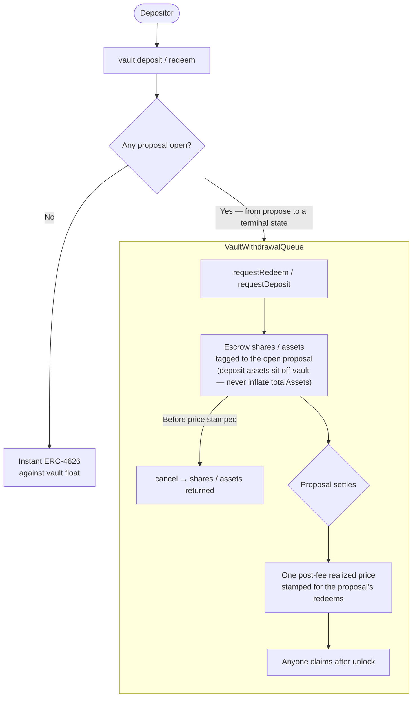

> While a proposal is open, redemptions queue and settle at the realized price. Outside that window, standard ERC-4626 deposit and redeem run against vault float. Depositors need no WOOD; at launch every vault is whitelist-only.

Vaults are standard ERC-4626. Instant `deposit` / `redeem` execute against idle float. They close for the whole life of a proposal, from `propose` until it settles or ends; the async queue is then the path in and out. The vault does not mark in-flight strategy positions.

**The lock is one predicate.** `redemptionsLocked()` and `depositsLocked()` both read `governor.openProposalCount() != 0`, live, on every call. A `Draft`, a `Pending` vote, a guardian review, an `Approved` proposal waiting to execute and an `Executed` strategy all lock. Only a terminal state (`Settled`, `Rejected`, `Expired`, `Cancelled`) unlocks. Nothing on the vault stores the flag.

**No proposal open** (`redemptionsLocked() == false`): standard ERC-4626. `deposit` / `mint` mint at the live price for a whitelisted receiver; `redeem` / `withdraw` execute instantly against vault float, capped so they cannot drain assets reserved for already-stamped queue claims (`QueueReserveBreached`). `requestDeposit` reverts `NoOpenProposal` and `requestRedeem` reverts `RedemptionsNotLocked`: exactly one path is open at any time.

**Any proposal open** (`redemptionsLocked() == true`): `deposit` / `mint` revert `DepositsLocked`; `maxWithdraw` / `maxRedeem` return 0. Depositors who want to leave call `requestRedeem`; depositors who want to enter call `requestDeposit`. Shares or assets escrow in `VaultWithdrawalQueue`. At settlement the vault stamps one frozen post-fee price for the proposal's redeems. Anyone then `claim`s.

## Who may deposit

`SyndicateFactory.depositsRestricted` is on at launch, so every vault is whitelist-only whatever its own `openDeposits` flag: the vault owner approves receivers with `approveDepositor` / `approveDepositors` and removes them with `removeDepositor`. The check runs on the **receiver**, not the caller, so a third party can pay for an approved depositor. `deposit`, `mint`, `requestDeposit` and the deposit claim all enforce it (`NotApprovedDepositor`). Once the factory owner clears the flag, a vault whose owner set `setOpenDeposits(true)` accepts anyone.

For integrators, `maxDeposit(receiver)` / `maxMint(receiver)` return 0 when the vault is paused, when any proposal is open, or when the receiver is not allowed; otherwise they return `type(uint256).max`. `maxWithdraw` / `maxRedeem` return 0 when paused or locked, and otherwise the instant capacity (float minus the queue reserve; `maxRedeem` also excludes shares pending in the queue).

## Full flow



## The queue: `requestRedeem` → stamp → `claim`

The queue is the only path out while a proposal is open.

1. **`requestRedeem(shares, owner)`** moves shares into the `VaultWithdrawalQueue`. They are not burned yet, and their redemption value is unknown until settlement. The request is tagged with the open proposal's id. Requires `redemptionsLocked() == true`; a caller other than the owner spends allowance.
2. **Settlement stamps one price.** `onProposalSettled` records a frozen `num/den` for that proposal: realized assets-per-share after both fees, using the same virtual offsets as ERC-4626 so queue claims round like the vault. The assets owed to that proposal's redeems are reserved in the vault from this moment.
3. **`claim(requestId)`** is permissionless. A redeem claim needs the stamp for its own proposal (`NotSettled`) and `redemptionsLocked() == false` (`VaultLocked`); it burns the escrowed shares and pays the vault asset at the stamped price. A deposit claim needs **no stamp**: once `depositsLocked()` is false it prices the escrowed assets live with `previewDeposit`, pushes them into the vault and mints to the receiver. It reverts while the vault is paused or if the receiver is no longer whitelisted; the owner can `cancel` instead.

`requestDeposit(assets, receiver)` is the symmetric entry: assets transfer straight from the caller into the queue (off-vault, so they never inflate `totalAssets`, never count toward the strategy's capital and can never be swept by a batch) and mint at the live share price on claim. Instant deposit is closed for the whole open-proposal window, so this is the only path in from `propose` through `Executed`.

`cancel(requestId)` is **request-owner only** (`NotQueueOwner`). A redeem can be cancelled only until its proposal is stamped (`AlreadySettled` afterwards; a post-stamp cancel would be a free look-back option). A deposit carries no frozen price, so its owner can cancel it any time before it is claimed, including after settlement. Cancel has no pause gate.

### When the proposal does not settle

Only settlement stamps a price. Cancel, veto, guardian block, a missed execution window and a lapsed collaboration window all end the proposal without one. A redeem tagged to a proposal that ends **Rejected**, **Expired** or **Cancelled** is therefore never stamped: its `claim` reverts `NotSettled` for good, and its shares stay in the queue, lowering everyone's `maxRedeem`, until the owner acts. The exit is `cancel`: it is allowed because nothing was stamped, it has no lock gate, and it returns the escrowed shares to the owner, who can then redeem instantly once nothing is open, or queue again under the next proposal. No keeper can clear it. Queued **deposits** are never stranded: they need no stamp and claim as soon as deposits unlock. See [stranded redeems](/cli/commands#stranded-redeems) for the CLI steps.

### Reserve invariant

Assets owed to stamped-but-unclaimed redeem requests stay in the vault. A subsequent proposal's execution, any instant withdrawal, any fee transfer and any settlement batch reverts if it would leave vault float below that reserve (`QueueReserveBreached`). Queued redeemers are always made whole; in-flight claims are never stranded.

`minBufferBps` (owner-set, 0 = off, at most 5,000) adds an idle-float floor on top: after any governor batch, float must be at least the reserve plus `balanceBefore × minBufferBps / 10_000`, else `BufferBreached`. Set it before the first proposal and never raise it while one is open, because the committed settlement calls would then fail the check.

## `totalAssets()`

```text
totalAssets() = vault float − queue reserve − escrowed unpaid fees
```

There is no strategy term. The vault does not mark in-flight positions. Pre-stamp escrowed redeem shares still float with the pool; once the settle price is stamped those shares leave the pricing supply, so a later `claim` moves neither the price nor anyone else's position. Shares carry a virtual-offset of the asset's own decimals on top (a 6-decimal asset gives 12-decimal shares), the first-depositor inflation protection.

Queue claims settle at the actual realized value, not any mid-proposal mark.

## Pause and rescue

The owner's `pause()` freezes `deposit`, `mint`, `withdraw`, `redeem`, `requestRedeem`, `requestDeposit`, the deposit claim and `executeGovernorBatch`. Redeem claims, queue cancels and the owner rescue functions still work. `rescueERC20` can move a non-asset token only to a strategy clone of the same vault, never the asset itself, and like `rescueERC721` and `rescueEth` it reverts `RedemptionsLocked` while any proposal is open.
